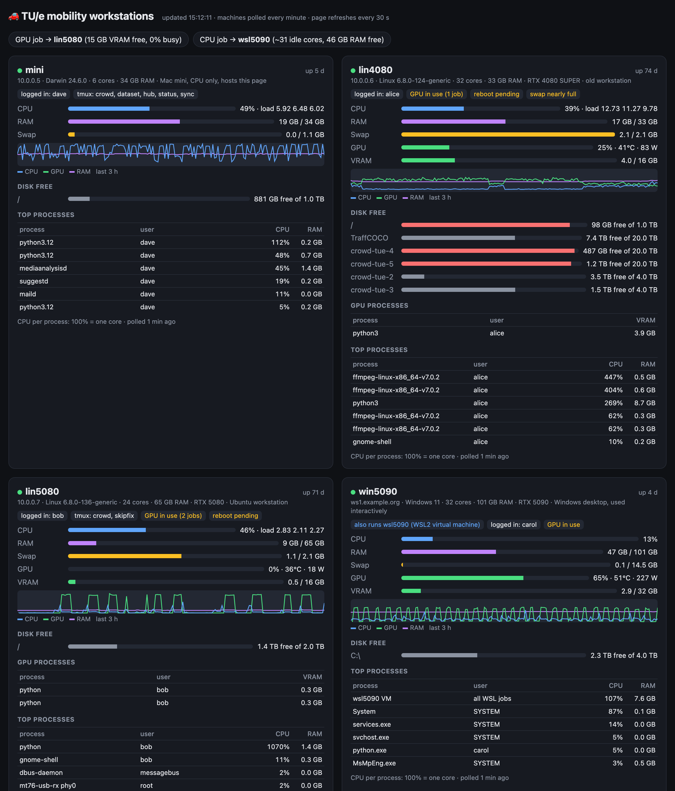
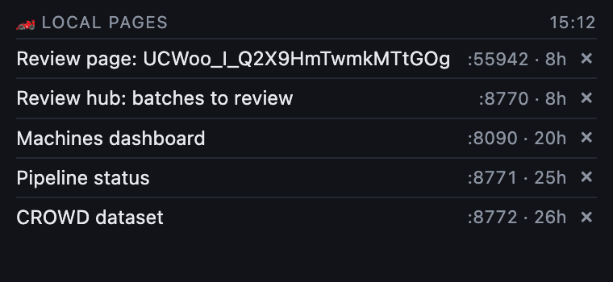
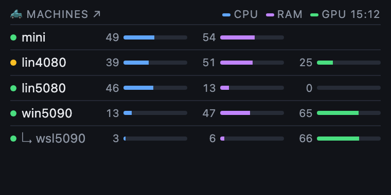

# dashboard-workstations

A small, dependency-light dashboard for a handful of shared lab workstations (Linux, Windows, macOS, WSL), plus desktop
widgets for a Mac. It answers "which machine is free for this job?" at a glance: CPU, RAM, swap, GPU and VRAM use, disks,
who is logged in, tmux sessions, the top processes and the last 3 hours of load. It also suggests a machine for a GPU job
and one for a CPU job.



| Local pages widget | Machines widget |
|---|---|
|  |  |

## How it works

- **`agent.py`** prints one JSON snapshot of the machine it runs on (`psutil`, and `nvidia-smi` when there is an NVIDIA
  GPU, also inside WSL). It runs only when asked, so the machines run nothing in between.
- **`server.py`** (standard library only) runs on one always-on machine. Every 60 s it runs the agent on each machine of
  `machines.json`: locally for the machine it runs on, over SSH for the others. It keeps 3 h of history in memory and
  serves the page on port 8090. Endpoints: `/` (the page), `/status.json` (latest numbers), `/config.json` (title,
  addresses and notes; never the SSH logins).
- **`index.html`** is the page; it refreshes every 30 s. A virtual machine (a machine with `"host"` in the config) is
  drawn as part of its host.
- **`widget.py`** (standard library only, macOS) serves small widgets on `127.0.0.1:8091`:
  - `/`: the web pages this user runs on localhost, with their start time and a stop button (with a confirmation);
  - `/machines`: a compact view of the dashboard;
  - more widgets from `widgets.json`, e.g. a page another server serves, with its data passed through.

  Each widget window fits its content and docks below the one before it (`dock.js`), top to bottom in the `order` of
  `widgets.json` (default: local pages, machines, then its `windows`). `/active` tells whether anyone can see the
  screen (this user's session on screen, unlocked, display on), so an animated widget can pause.
- **`widgets.sh`** starts `widget.py` and opens the widgets as small Chrome app windows in a column at the top-left.

- **`wsl_yield.py`** (standard library only) runs inside the WSL of a Windows PC that people also use at its desk. It
  pauses that WSL user's jobs (python, ffmpeg, yt-dlp, rsync, ...) with SIGSTOP while Windows is in use, and resumes
  them with SIGCONT once it has not been for 10 minutes. "In use" means a program of `ALWAYS` is running (e.g. a
  driving simulator's 3D engine, driven with a wheel and no keyboard), or there was keyboard or mouse input on its
  desktop (at the PC or over remote desktop) in the last 10 minutes; game controllers do not count (a racing wheel
  can send reports nonstop with nobody at it). It reads this from the dashboard: `agent.py`
  reports a Windows machine's `desktop` (idle minutes, and the running programs). The idle time comes from
  `desktop_idle.pyw`, run in the desktop session by a scheduled task at logon (`quser` shows the console session as
  never idle, so it is only a fallback). WSL started by a
  background task cannot run Windows programs itself. `~/.wsl_yield.json` says what is paused and why. If the dashboard
  cannot be read, nothing changes, so jobs stay paused while it is down.

## Setup

1. **Each machine:** Python 3.9+ with `psutil` (`pip install --user psutil`), and `agent.py` in `~/compute-dash/`
   (Windows: `C:\Users\<you>\compute-dash\`).
2. **The dashboard machine:** copy `machines.example.json` to `machines.json` and list the machines. For each remote
   machine, `"ssh"` holds the arguments after `ssh` (login, port, host). Create a key for the dashboard:

   ```bash
   ssh-keygen -t ed25519 -N "" -C compute-dash -f ~/.ssh/id_dash
   ```

   and authorize it on each machine **restricted to running the agent**, so the key can do nothing else:

   ```text
   # ~/.ssh/authorized_keys (Linux, macOS, WSL)
   restrict,command="/usr/bin/python3 compute-dash/agent.py" ssh-ed25519 AAAA... compute-dash
   # C:\ProgramData\ssh\administrators_authorized_keys (Windows, admin accounts)
   restrict,command="py -3.13 C:/Users/<you>/compute-dash/agent.py" ssh-ed25519 AAAA... compute-dash
   ```

3. **Run the server** and keep it running, e.g. with cron restarting it when it is not running:

   ```text
   */5 * * * * pgrep -qf compute-dash/server.py || (cd $HOME/compute-dash && nohup python3 server.py >> server.log 2>&1 &)
   ```

   Then open `http://<dashboard machine>:8090`.

4. **Widgets (optional, macOS with Google Chrome):** copy `widgets.example.json` to `widgets.json` (`dash`: the
   dashboard's address; `refresh`: seconds between updates, e.g. 30 on an always-on screen and 3600 on a laptop) and run
   `./widgets.sh`. To show them all the time, run `widgets.sh` from a LaunchAgent at login.

5. **WSL on a shared Windows PC (optional):** on the PC, have `desktop_idle.pyw` (next to `agent.py`) started at
   logon in the desktop session, e.g. a scheduled task "At log on", "Run only when user is logged on", action
   `pyw.exe -3.13 C:\Users\<you>\compute-dash\desktop_idle.pyw`. In its WSL, set `YIELD_HOST` (the Windows machine's name in
   `machines.json`), `DASH` and `ALWAYS` (in the script) and keep `wsl_yield.py` running, e.g. with cron:

   ```text
   */5 * * * * pgrep -f "^/usr/bin/python3 -u wsl_yield.py" >/dev/null || (cd $HOME/compute-dash && nohup /usr/bin/python3 -u wsl_yield.py >> wsl_yield.log 2>&1 &)
   ```

## Notes

- There is no login: serve it on a trusted network only. The page and `/config.json` show machine names, addresses and
  notes, never the SSH logins.
- The load the dashboard adds is small: one agent run (about a second of one core) per machine per minute.
- `machines.json`, `widgets.json`, logs and the widgets' Chrome profiles are not committed (`.gitignore`).
