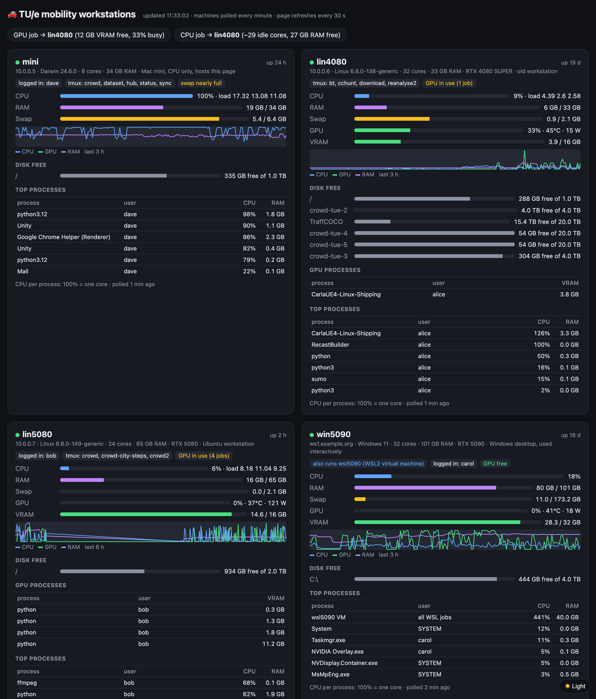
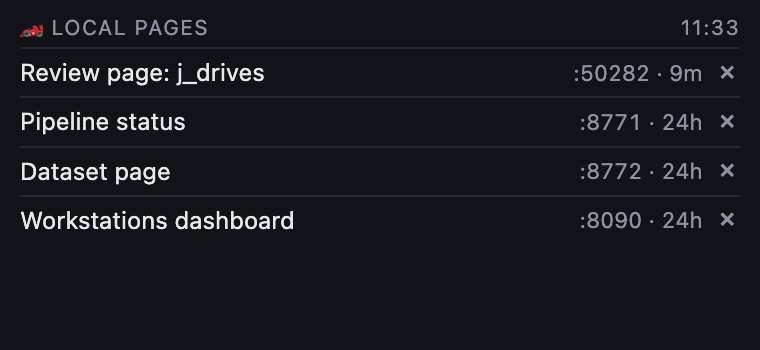
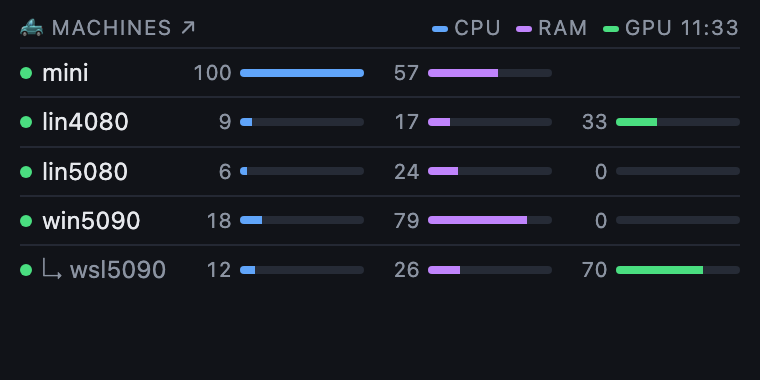

# dashboard-workstations

A small, dependency-light dashboard for a handful of shared lab workstations (Linux, Windows, macOS, WSL), plus desktop
widgets for a Mac. It answers "which machine is free for this job?" at a glance: CPU, RAM, swap, GPU and VRAM use, disks,
who is logged in, tmux sessions, the top processes and the last 3 hours of load. It also suggests a machine for a GPU job
and one for a CPU job.



| Local pages widget | Machines widget |
|---|---|
|  |  |

## How it works

- **`agent.py`** prints one JSON snapshot of the machine it runs on (`psutil`, and `nvidia-smi` when there is an NVIDIA
  GPU, also inside WSL). It runs only when asked, so the machines run nothing in between.
- **`server.py`** (standard library only) runs on one always-on machine. Every 60 s it runs the agent on each machine of
  `machines.json`: locally for the machine it runs on, over SSH for the others. It keeps 3 h of history in memory and
  serves the page on port 8090. Endpoints: `/` (the page), `/status.json` (latest numbers), `/config.json` (title,
  addresses and notes; never the SSH logins).
- **`index.html`** is the page; it refreshes every 30 s. A virtual machine (a machine with `"host"` in the config) is
  drawn as part of its host.
- **`widget.py`** (standard library only, macOS) serves small widgets on `127.0.0.1:8091`:
  - `/`: the web pages this user runs on localhost, with their start time and a stop button (with a confirmation);
  - `/machines`: a compact view of the dashboard;
  - more widgets from `widgets.json`, e.g. a page another server serves, with its data passed through.

  Each widget window fits its content and docks below the one before it (`dock.js`), top to bottom in the `order` of
  `widgets.json` (default: local pages, machines, then its `windows`). `/active` tells whether anyone can see the
  screen (this user's session on screen, unlocked, display on), so an animated widget can pause.
- **`widgets.sh`** starts `widget.py` and opens the widgets as small Chrome app windows in a column at the top-left.

- **`wsl_yield.py`** (standard library only) runs inside the WSL of a Windows PC that people also use at its desk. It
  pauses that WSL user's jobs (python, ffmpeg, yt-dlp, rsync, node, CARLA's Linux server, SUMO, ...) with SIGSTOP while
  Windows is in use, and resumes them with SIGCONT once it has not been for 10 minutes. "In use" means a program of
  `ALWAYS` is running (a driving simulator's 3D engine or a CARLA server, driven with a wheel and no keyboard; a CARLA
  server only until the desktop has had no keyboard or mouse input for 90 minutes, as one is often left open), or the
  desktop had keyboard or mouse input (at the PC or over remote desktop) in at least 12 of the last 30 20-second slots;
  a remote desktop window left open elsewhere sends a stray mouse move now and then, and game controllers do not count
  (a racing wheel can send reports nonstop with nobody at it). It reads this from the dashboard: `agent.py` reports a
  Windows machine's `desktop` (idle time, the slot count, and the running programs). The idle time comes from
  `desktop_idle.pyw`, run in the desktop session by a scheduled task at logon (`quser` shows the console session as
  never idle, so it is only a fallback). WSL started by a background task cannot run Windows programs itself.
  `~/.wsl_yield.json` says what is paused and why. If the dashboard cannot be read, nothing changes, so jobs stay
  paused while it is down.

  A simulation (an `ALWAYS` program, or the flag file a "free the GPU" shortcut on the Windows desktop makes before one
  starts) frees the GPU instead, as a paused process keeps its GPU memory: jobs that hold GPU models are ended and their
  runner waits on a pause file until the simulation is over. Jobs of `RESTART` are always ended rather than paused, and
  started again in their tmux session once Windows is free.
- **`win_yield.pyw`** (Windows, `psutil`) pauses background work on the Windows side at the same moments: the
  processes of the background session (scheduled tasks, SSH) whose program or command line is in one of its `PROJECTS`
  folders, and everything they started (e.g. a build's `msbuild`, `cl.exe` and `git`, or a CARLA server). What someone
  starts at the desk is never paused. `wsl_yield.py` decides and writes `C:\Users\Public\wsl_yield.json` every 30 s;
  `win_yield.pyw` suspends or resumes the work by it, and resumes everything when that file is more than 10 minutes old
  (WSL down). It writes `C:\Users\Public\win_yield.json`: what it paused, and the programs running outside that
  work, which `wsl_yield.py` uses for `ALWAYS`, so a CARLA server of the background work is not taken for someone
  driving.

## Setup

1. **Each machine:** Python 3.9+ with `psutil` (`pip install --user psutil`), and `agent.py` in `~/compute-dash/`
   (Windows: `C:\Users\<you>\compute-dash\`).
2. **The dashboard machine:** copy `machines.example.json` to `machines.json` and list the machines. For each remote
   machine, `"ssh"` holds the arguments after `ssh` (login, port, host). Create a key for the dashboard:

   ```bash
   ssh-keygen -t ed25519 -N "" -C compute-dash -f ~/.ssh/id_dash
   ```

   and authorize it on each machine **restricted to running the agent**, so the key can do nothing else:

   ```text
   # ~/.ssh/authorized_keys (Linux, macOS, WSL)
   restrict,command="/usr/bin/python3 compute-dash/agent.py" ssh-ed25519 AAAA... compute-dash
   # C:\ProgramData\ssh\administrators_authorized_keys (Windows, admin accounts)
   restrict,command="py -3.13 C:/Users/<you>/compute-dash/agent.py" ssh-ed25519 AAAA... compute-dash
   ```

3. **Run the server** and keep it running, e.g. with cron restarting it when it is not running:

   ```text
   */5 * * * * pgrep -qf compute-dash/server.py || (cd $HOME/compute-dash && nohup python3 server.py >> server.log 2>&1 &)
   ```

   Then open `http://<dashboard machine>:8090`.

4. **Widgets (optional, macOS with Google Chrome):** copy `widgets.example.json` to `widgets.json` (`dash`: the
   dashboard's address; `refresh`: seconds between updates, e.g. 30 on an always-on screen and 3600 on a laptop) and run
   `./widgets.sh`. To show them all the time, run `widgets.sh` from a LaunchAgent at login.

5. **WSL on a shared Windows PC (optional):** on the PC, have `desktop_idle.pyw` (next to `agent.py`) started at
   logon in the desktop session, e.g. a scheduled task "At log on", "Run only when user is logged on", action
   `pyw.exe -3.13 C:\Users\<you>\compute-dash\desktop_idle.pyw`. In its WSL, set `YIELD_HOST` (the Windows machine's name in
   `machines.json`), `DASH` and `ALWAYS` (in the script) and keep `wsl_yield.py` running, e.g. with cron:

   ```text
   */5 * * * * pgrep -f "^/usr/bin/python3 -u wsl_yield.py" >/dev/null || (cd $HOME/compute-dash && nohup /usr/bin/python3 -u wsl_yield.py >> wsl_yield.log 2>&1 &)
   ```

   To pause work on the Windows side too, set `PROJECTS` in `win_yield.pyw` and keep it running elevated, as the
   account the background work runs as (a process started with highest privileges can only be paused by one that has
   them too), e.g. a scheduled task "Run whether user is logged on or not" with "Do not store password" (S4U), "Run
   with highest privileges", triggers "At startup" and every 10 minutes, "Do not start a new instance", no time limit,
   action `pyw.exe -3.13 C:\Users\<you>\compute-dash\win_yield.pyw`. Its log is `win_yield.log` next to it.

## Notes

- There is no login: serve it on a trusted network only. The page and `/config.json` show machine names, addresses and
  notes, never the SSH logins.
- The load the dashboard adds is small: one agent run (about a second of one core) per machine per minute.
- `machines.json`, `widgets.json`, logs and the widgets' Chrome profiles are not committed (`.gitignore`).
